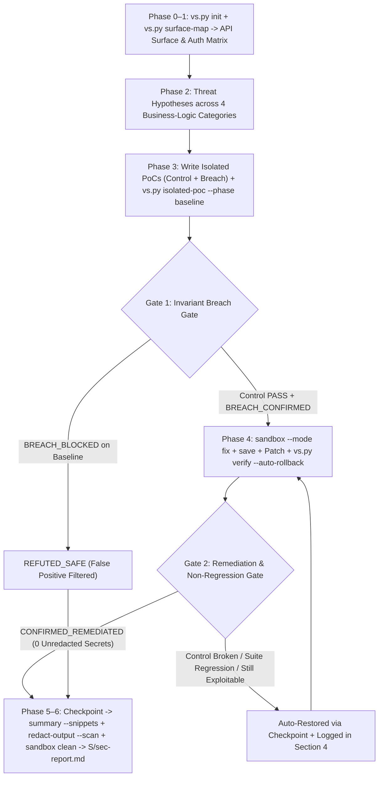

# VeriSec 🛡️🔍

[](https://agentskills.io)
[](https://github.com/lufus4826-eng/verisec/actions/workflows/ci.yml)
[](https://github.com/lufus4826-eng/verisec/releases/tag/v1.1.0)
[](LICENSE)
[](#installation)
[](#supported-stacks--language-adapters)
[](#prerequisites)
[](https://github.com/lufus4826-eng/verihunt)

> **VeriSec — Business-Logic & Authorization Security Auditing Skill with 100% Network-Isolated PoCs, Secret Redaction & Dual-Gate Verification.**  
> Stop relying on noisy SAST regex scans that flag harmless code and miss real authorization bugs. VeriSec maps API endpoints and authorization guards (`surface-map`), executes Proof-of-Concept exploits in **100% outbound network-isolated sandboxes** (`isolated-poc`), automatically redacts leaked API keys, JWTs, and passwords (`redact-output`), and verifies remediation patches inside a sandbox so **neither attackers nor overly strict patches can slip through**.

---

## Why VeriSec?

When you ask a traditional scanner or AI coding agent to *"audit security or fix authorization bugs"*, four things usually go wrong:
1. **Static scanner blindness & false positives:** Regex/SAST scanners cannot tell whether User B can read User A's invoice (**IDOR/BOLA**), whether an endpoint is missing an admin guard compared to sibling routes (**Missing Auth Guard**), whether `user.update(payload)` lets someone submit `{"role": "admin"}` (**Mass Assignment**), or whether 8 concurrent threads can redeem a 1-use voucher 8 times (**Race Double-Spend**).
2. **Over-strict patches breaking legitimate users:** Asking an AI to "lock down" an endpoint often rejects valid multi-field requests or breaks existing application features.
3. **Unsafe exploit testing & leaked credentials:** Running ad-hoc exploit scripts can touch external hosts or print raw Bearer tokens, JWTs, and API keys (`sk-live-...`) straight into logs and LLM context.
4. **Token bloat:** Dumping full HTTP traces and raw test runner logs floods the agent's context window.

**VeriSec (`v1.1.0`) solves all four using a zero-dependency Python CLI engine (`scripts/vs.py`) and strict 2-Layer Dual-Gate verification:**
- **Gate 1 — Invariant Breach Gate (`isolated-poc --phase baseline` + `verify --gate1-only`):**
  - **Authorized Control Pass:** A legitimate authorized request (`test_control_*`) **must** succeed (`PASS`), proving the route and harness work.
  - **Explicit Breach Proof (`VERISEC_BREACH_PROVEN` / `VERISEC_POC:`):** An unauthorized, cross-account, mass-assigned, or concurrent request must prove a boundary breach either via `VERISEC_POC:` JSON (`"breach_detected":true`) or an invariant failure tagged with `VERISEC_BREACH_PROVEN`. Unmarked accidental test failures are rejected as `HARNESS_BROKEN`, and already-guarded baseline endpoints resolve to **`REFUTED_SAFE`** (zero false positives).
  - **Dual-Runtime Network Isolation (`VERISEC_NET_GUARD` for Python & Node.js):** Injects both Python's `sitecustomize.py` (`PYTHONPATH`) and Node.js's `netguard_node.cjs` (`NODE_OPTIONS=--require`), blocking non-loopback sockets, DNS lookups, `http`/`https`, and `fetch` while allowing `127.0.0.1` / `localhost` / `::1` and Unix IPC sockets (alongside `GOPROXY=off`, `CARGO_NET_OFFLINE=true`, `npm_config_offline=true`, and blackholed proxy vars for compiled stacks).
- **Gate 2 — Remediation & Non-Regression Gate (`verify --auto-rollback` on `S/sandbox-fix/`):**
  - **Breach Blocked:** Re-running the identical PoC against `S/sandbox-fix/` proves the unauthorized action is blocked (`BREACH_BLOCKED`).
  - **100% Functional & Multi-Worker Safe Preservation:** Both the PoC's `Authorized Control` request **and** the project's existing test suite (`--test-cmd`) pass 100%. Overly strict patches (`REJECTED_CONTROL_BROKEN`), test regressions (`REJECTED_TEST_REGRESSION`), and unsafe in-memory locks added to DB/ORM/Redis-backed race handlers (`REJECTED_IN_MEMORY_LOCK_ON_DB` — enforcing atomic `UPDATE ... WHERE` or `SELECT ... FOR UPDATE`) are **rolled back byte-for-byte automatically**.
  - **Raw, Encoded & Canary Secret Redaction (`redact-output`):** Masks `Authorization` headers, JWTs (`eyJ...`), API keys (`sk-`, `ghp_`, `AKIA`, `AIza`, `xox...`), PEM keys, DB credential URLs, key-value secrets, **Base64-encoded secrets**, **URL-encoded secrets**, and **session-registered canary secrets** (`--register-secret`) across logs, diffs, worklogs, and reports (`unredacted_remaining=0`).

---

## Verified E2E Case Study (`examples/vault_api_demo`)

Tested end-to-end across all 6 phases via [`examples/vault_api_demo/run_demo.py`](examples/vault_api_demo/run_demo.py) — see the generated [`sample-sec-report.md`](examples/vault_api_demo/sample-sec-report.md):

| ID | Category | Handler (`vault_app/routes.py`) | Gate 1 (Isolated Baseline) | Gate 2 (`S/sandbox-fix/` Remediation) | Dual-Gate Verdict |
|---|---|---|---|---|---|
| **SEC-1** | `IDOR_BOLA` | `get_invoice` | Ctrl=`PASS`, `BREACH_CONFIRMED` (leaked `sk-live-[REDACTED_KEY]`) | Ctrl=`PASS`, `BREACH_BLOCKED`, Suite=`PASS` | **CONFIRMED_REMEDIATED** |
| **SEC-2** | `MISSING_AUTH_GUARD` | `export_all_ledgers` | Ctrl=`PASS`, `BREACH_CONFIRMED` (member & anon dump) | Ctrl=`PASS`, `BREACH_BLOCKED`, Suite=`PASS` | **CONFIRMED_REMEDIATED** |
| **SEC-3** *(Try #1)* | `MASS_ASSIGNMENT` | `update_profile` *(over-strict `len(payload) > 1` check)* | Ctrl=`PASS`, `BREACH_CONFIRMED` | **Ctrl=`FAIL`**, Suite=`FAIL` | **REJECTED_CONTROL_BROKEN + AUTO_RESTORED** |
| **SEC-3** *(Try #2)* | `MASS_ASSIGNMENT` | `update_profile` *(explicit field whitelist)* | Ctrl=`PASS`, `BREACH_CONFIRMED` | Ctrl=`PASS`, `BREACH_BLOCKED`, Suite=`PASS` | **CONFIRMED_REMEDIATED** |
| **SEC-4** | `RACE_DOUBLE_SPEND` | `redeem_promo_voucher` *(8 barrier-synced threads)* | Ctrl=`PASS`, `BREACH_CONFIRMED` (`8 != 1` uses on 1-use voucher) | Ctrl=`PASS`, `BREACH_BLOCKED` (`store.lock`), Suite=`PASS` | **CONFIRMED_REMEDIATED** |
| **SEC-5** | `IDOR_BOLA` | `transfer_funds` *(already owner-checked)* | Ctrl=`PASS`, `BREACH_BLOCKED` | — | **REFUTED_SAFE** (false positive filtered) |

> **Key takeaway from SEC-3 & SEC-1:** When `SEC-3 (Attempt 1)` added an overly strict guard (`len(payload) > 1`), Gate 2 immediately caught the broken legitimate multi-field update (`REJECTED_CONTROL_BROKEN`) and restored `S/sandbox-fix/` byte-for-byte before `Attempt 2` applied an explicit field whitelist. Meanwhile in `SEC-1`, the leaked invoice token `sk-live-...` was automatically masked to `sk-live-[REDACTED_KEY]` in every log, snippet, and summary (`unredacted_remaining=0 status=CLEAN`), finishing with `cleanliness: CLEAN (0 new/modified files outside .bughunt/)`.

---

## Try the 1-Command Live Demo

Clone the repo and run the full 6-phase VeriSec workflow (including `surface-map`, 100% network isolation, automatic secret redaction, Gate 2 auto-rollback, and sandbox cleanliness verification) in one command on an isolated temporary workspace:

```bash
git clone https://github.com/lufus4826-eng/verisec.git
cd verisec
python -B examples/vault_api_demo/run_demo.py
```

---

## Quick Start

### Prerequisites
- **Python 3.9+** available on `PATH` as `python` (used by `scripts/vs.py`; **zero external `pip` packages required**).
- Your target project's native runtime/toolchain (Python, Node.js/TS, Go, Java/Kotlin, .NET, or Rust).

### Installation

#### 0. Full VeriHunt Suite via VeriPilot (Recommended — One-Command Install)
Install `VeriPilot` + `VeriPR` + `VeriHunt` + `VeriSec` + `VeriPerf` together across 6 agent platforms:
```bash
git clone https://github.com/lufus4826-eng/veripilot.git ~/.gemini/config/skills/veripilot
python ~/.gemini/config/skills/veripilot/scripts/vpilot.py install --platform antigravity   # or --platform claude | --platform all
```

#### 1. Claude Code
```bash
# User-global installation (Recommended)
git clone https://github.com/lufus4826-eng/verisec.git ~/.claude/skills/verisec

# Or project-local installation
git clone https://github.com/lufus4826-eng/verisec.git .claude/skills/verisec
```

#### 2. Google Antigravity / Gemini CLI
```bash
# Linux / macOS
git clone https://github.com/lufus4826-eng/verisec.git ~/.gemini/config/skills/verisec

# Windows (PowerShell)
git clone https://github.com/lufus4826-eng/verisec.git "$HOME\.gemini\config\skills\verisec"
```

#### 3. Cursor / Windsurf / Roo Code / Cline / Other Agent Runtimes
```bash
git clone https://github.com/lufus4826-eng/verisec.git .agents/skills/verisec
```

### Example Prompts
```text
/verisec perform a business-logic security audit for IDOR/BOLA, missing auth guards, mass assignment, and race conditions
/verisec map API auth guards and prove any privilege-escalation or double-spend flaws in isolated sandbox PoCs
/verisec audit src/billing for authorization bypasses and verify fixes without breaking existing tests
```

---

## Methodology & 6-Phase Workflow



| Phase | Purpose | Enforcement Mechanism |
|---|---|---|
| **Phase 0–1: Surface & Auth Matrix** | Map endpoints, attached auth guards, external inputs & risk signals | `vs.py init` + `vs.py surface-map` (AST docstring-immune scan, `<=35` lines) |
| **Phase 2: Threat Hypothesis** | Prioritize testable bypass hypotheses across all 4 categories | `resources/threat-taxonomy.md` + `resources/lang/<lang>.md` |
| **Phase 3: Safe Exploit PoC (Gate 1)** | Prove real vulnerability with an authorized control & offline PoC | `vs.py isolated-poc --phase baseline` + `vs.py verify --gate1-only` |
| **Phase 4: Patch Verification (Gate 2)** | Prove patch blocks breach without breaking authorized users or tests | `vs.py sandbox --mode fix\|save` + `vs.py verify --auto-rollback --test-cmd` |
| **Phase 5: Round 3 Checkpoint** | Present interim findings and confirm deeper audit vs. final report | Compact `<=25`-line interim draft in `S/sec-report.md` + `vs.py log` |
| **Phase 6: Security Advisory & Hygiene** | Deliver redacted report, verified diffs & 100% clean host tree | `vs.py summary --snippets` + `redact-output --scan` + `sandbox --mode diff\|clean` |

---

## `scripts/vs.py` CLI Reference

| Subcommand | Description |
|---|---|
| `init [--root .]` | Creates `.bughunt/sec-<YYYYMMDD-HHMMSS>/{pocs,logs,tmp}` + `.cache`, writes Python + Node.js netguards (`sitecustomize.py`, `netguard_node.cjs`), snapshots `fs-before.txt`, initializes `worklog.md`, and emits 1-line JSON. |
| `surface-map [--root .] [--scope dir] [--s S]` | Runs Python AST (excluding comments/docstrings) + multi-language scanning for `IDOR_BOLA`, `MISSING_AUTH_GUARD`, `MASS_ASSIGNMENT`, and `RACE_DOUBLE_SPEND`, printing a ranked `<=35`-line Auth Matrix. |
| `isolated-poc --s S --id ID --phase baseline\|remediation --category CAT -- <cmd>` | Runs PoCs under `VERISEC_OFFLINE=1` with Python+Node.js socket/DNS/HTTP guards, automatic raw+Base64+URL-encoded secret redaction, `VERISEC_POC:` JSON or `VERISEC_BREACH_PROVEN`-tagged runner parsing, and a `<=10`-line digest. |
| `redact-output (--text STR \| --input-file PATH \| --s S --register-secret VAL \| --s S --scan)` | Scrubs Bearer/Basic headers, JWTs, API keys, PEM keys, DB URLs, Base64/URL-encoded secrets, and registered canary secrets; `--scan` verifies `unredacted_remaining=0` across all session logs and reports. |
| `verify --s S --id ID [--gate1-only] [--auto-rollback] [--test-cmd "..."]` | Enforces Gate 1 (`BREACH_CONFIRMED` vs `REFUTED_SAFE`) and Gate 2 (`BREACH_BLOCKED` + Control `PASS` + project suite `PASS` + rejects in-memory locks on DB-backed races + `0` secret leaks), auto-restoring checkpoints on rejection. |
| `sandbox --s S --mode create\|fix\|save\|rollback\|diff\|clean [--id ID]` | Manages `S/sandbox-fix/`, per-target checkpoints (`save`/`rollback`), secret-redacted unified diffs (`<=8,000` chars), and host cleanliness verification (`fs-before.txt` vs `fs-after.txt`). |
| `log --s S [--status "..."] [--entry "..."]` | Atomically updates `Status:` on line 1 of `S/worklog.md` and appends redacted timestamped 1-line entries. |
| `summary --s S [--snippets]` | Emits redacted Markdown Dual-Gate tables and compact PoC evidence snippets from session JSON logs without reading raw logs. |

### Supported PoC Protocols
1. **Standard Test Runner Mode (`unittest` / `pytest` / `node:test` / `go test`):** Include at least one passing positive control test named `test_control_*` (or `Control_*`) and security invariant test(s) (`test_unauthorized_*`, `test_idor_*`, `test_mass_assignment_*`, `test_race_*`) whose failure message includes **`VERISEC_BREACH_PROVEN:`** (unmarked test errors are rejected as `HARNESS_BROKEN`).
2. **Structured JSON Mode (`VERISEC_POC:`):** Print a single line to stdout:
```text
VERISEC_POC:{"id":"sec1","category":"IDOR_BOLA","control_authorized":"PASS","breach_detected":true,"network_isolated":true,"details":"User B read User A invoice INV-101"}
```

---

## Supported Stacks & Language Adapters

| Language | PoC Harness & Isolation Strategy | Concurrency / Race Primitive |
|---|---|---|
| **Python** | `VERISEC_TARGET_ROOT` + `PYTHONPATH` + `sitecustomize.py` socket/DNS guard (`unittest` / `pytest`) | `threading.Barrier(N)` (or atomic SQL on DB) |
| **Node.js / TS** | `NODE_OPTIONS=--require netguard_node.cjs` (`net`/`dns`/`http`/`https`/`fetch` guard) + `pathToFileURL(VERISEC_TARGET_ROOT)` (`node:test` / `jest` / `vitest`) | `Promise.all(...)` |
| **Go** | `S/sandbox-fix/`, `net/http/httptest.NewRecorder` (in-process), `go test -race`, `GOPROXY=off`, blackholed proxy vars | `sync.WaitGroup` + `chan struct{}` |
| **Java / Kotlin (JVM)** | `S/sandbox-fix/`, `MockMvc` (in-process), `mvn -o test` / `gradle --offline test`, blackholed proxy vars | `CyclicBarrier(N)` |
| **C# (.NET)** | `S/sandbox-fix/`, `WebApplicationFactory` / `TestServer` (in-process), `dotnet test --no-restore`, blackholed proxy vars | `CountdownEvent(N)` / `Task.WhenAll` |
| **Rust** | `S/sandbox-fix/`, `oneshot` / `call_service` (in-process), `cargo test --offline`, `CARGO_NET_OFFLINE=true`, blackholed proxy vars | `std::sync::Barrier` / `tokio::sync::Barrier` |

---

## Repository Structure & Session Deliverables

### Repository Layout
```text
verisec/
├── SKILL.md                          # Master 6-phase workflow & token efficiency guardrails
├── README.md                         # Documentation & Dual-Gate security methodology
├── CONTRIBUTING.md                   # Contributor & security adapter authoring guide
├── LICENSE                           # MIT License
├── scripts/
│   └── vs.py                         # Zero-dependency stdlib Python CLI engine (v1.1)
├── tests/
│   └── test_vs_cli.py                # 12-suite cross-platform unit & integration tests
├── examples/
│   └── vault_api_demo/               # 1-command runnable E2E showcase + sample-sec-report.md
└── resources/
    ├── threat-taxonomy.md            # 4 business-logic threat categories & PoC idioms
    ├── report-template.md            # English 7-section report template (Phase 6 lazy-load)
    ├── report-template-th.md         # Thai 7-section report template (Phase 6 lazy-load)
    └── lang/                         # Language-specific isolated PoC adapters
        ├── 00-common.md              # VERISEC_POC protocol, isolation & redaction rules
        ├── python.md
        ├── js-ts.md
        ├── go.md
        ├── jvm.md
        ├── dotnet.md
        └── rust.md
```

### Session Output (`.bughunt/sec-<YYYYMMDD-HHMMSS>/`)
```text
.bughunt/sec-20261118-090047/
├── sec-report.md         # Final 7-section security advisory & sandbox-verified diffs
├── worklog.md            # Redacted append-only progress journal
├── pocs/                 # Reproducible isolated PoC scripts
└── logs/                 # Redacted execution logs, surface_map.json, Dual-Gate JSONs & fs snapshots
```
> **Note:** Add `.bughunt/` to `.gitignore` or `.git/info/exclude` — session logs and PoC traces should never be committed into your target repository.

---

## Veri-Suite Ecosystem

[-2ea44f.svg)](https://github.com/lufus4826-eng?tab=repositories&q=topic%3Averi-suite)

VeriSec is part of the **Veri-Suite Ecosystem**, sharing the `.bughunt/` isolation convention and empirical Dual-Gate verification philosophy:

| Skill | Role in Causal Chain | Pinned Release | Repository |
|---|---|---|---|
| **VeriPilot** | Hub, Smart Router, Cumulative Overlay & 1-Command Installer | `v1.0.1` | [`lufus4826-eng/veripilot`](https://github.com/lufus4826-eng/veripilot) |
| **VeriPR** | Stage 1a: Pre-Commit & PR Differential Guard (`1-hop` ripple + `schema_hash`) | `v1.1.0` | [`lufus4826-eng/veripr`](https://github.com/lufus4826-eng/veripr) |
| **VeriHunt** | Stage 1b: Deep Evidence-Based Bug Hunting & Sandbox Verifier | `v2.1.0` | [`lufus4826-eng/verihunt`](https://github.com/lufus4826-eng/verihunt) |
| **VeriSec** *(Current Repo)* | Stage 2: Defensive AppSec, Authz Invariant & Air-Gapped PoC Verifier | `v1.1.0` | [`lufus4826-eng/verisec`](https://github.com/lufus4826-eng/verisec) |
| **VeriPerf** | Stage 3: Statistical Profiling (`p50`/`p95`, Peak RAM, `ABBA` Interleaving) | `v1.1.1` | [`lufus4826-eng/veriperf`](https://github.com/lufus4826-eng/veriperf) |

---

## Contributing & License

- Contributions, new language adapters, and AST/surface-map improvements are welcome! See [CONTRIBUTING.md](CONTRIBUTING.md).
- Licensed under the **MIT License** — see [LICENSE](LICENSE).
